<p align="center">
  
</p>

# Erg

A minimal Android TV client for [Jellyfin](https://jellyfin.org), with built-in [Seerr](https://github.com/seerr-team/seerr) requests.

> [!NOTE]
> Erg is an unofficial client. It is not affiliated with or endorsed by the Jellyfin project.

## What it is

Erg is the official [Jellyfin for Android TV](https://github.com/jellyfin/jellyfin-androidtv) app (currently based on **v0.20.0**) with the visual style of [DUNE](https://github.com/Sam42a/DUNE) re-applied on top. DUNE was a much-loved fork with a clean, minimalist look that has since been archived; Erg keeps that look alive on a current, maintained base.

Starting from upstream rather than from DUNE means Erg keeps the official app's player, codec handling, server sync and fixes, and can keep merging new upstream releases.

## Features

**The DUNE look**
- Centered icon toolbar, featured carousel, text library tabs
- Flat cards with a white focus ring instead of zoom
- DUNE's eight themes, dynamic backdrop colors, theme songs
- Restyled detail pages, search, login and user picker, playback overlay
- Extra home rows: Because you watched, Collections, Discover, Recently released, Watch it again, Music videos

**Seerr requests**
- **Discover** in the home toolbar: trending, popular and upcoming movies and shows, plus search
- Request movies, all seasons of a show, or pick seasons; titles you already have open straight in your library
- Sign in with Jellyfin Quick Connect (approve a code on your phone) or username and password; each Jellyfin user on the TV gets their own Seerr session

**Playback**
- Choose the player in **Settings → Playback → Video player**: ExoPlayer (best for HDR and Dolby Vision) or **mpv**, which direct-plays almost any file with full ASS subtitle rendering (Android 8.0+)
- Dolby Vision profile 7 (UHD Blu-ray rips) plays as HDR10 on devices that can't decode it, instead of transcoding
- Audio and subtitle choices are remembered per series and per user, matched by language plus forced / SDH / commentary, so the next episode picks the same kind of track

**Polish**
- Crossfading carousel, animated focus states, and loading skeletons instead of spinners

## Install

Erg installs alongside the official Jellyfin app and DUNE (package `dev.erg.tv`).

Download the APK from the latest CI run (Actions → *App / Build* → artifacts), or build it yourself, then sideload it:

```sh
adb connect <tv-ip>
adb install erg-*.apk
```

Seerr is optional: set it up in **Settings → Seerr**.

## Building

Requirements: JDK 21 and the Android SDK (platform 37).

```sh
./gradlew assembleDebug        # app/build/outputs/apk/debug/
./gradlew testDebugUnitTest
```

## Keeping up with upstream

The `main` branch tracks the upstream release Erg is based on; `erg` carries Erg's changes. To move to a newer upstream release, merge its tag into `erg`:

```sh
git remote add upstream https://github.com/jellyfin/jellyfin-androidtv.git   # first time only
git fetch upstream --tags
git merge v0.21.0   # example
```

## Credits

- [Jellyfin for Android TV](https://github.com/jellyfin/jellyfin-androidtv) by the Jellyfin contributors: the foundation of this app
- [DUNE](https://github.com/Sam42a/DUNE) by Sam42a: the visual design Erg carries forward
- [Seerr](https://github.com/seerr-team/seerr): the request server Erg integrates with

## License

GPL-2.0, like the projects it builds on. See [LICENSE](LICENSE).

The mpv engine uses [libmpv-android](https://github.com/jarnedemeulemeester/libmpv-android). Its wrapper code is MIT, but the published package (with the bundled mpv/FFmpeg binaries) declares GPL-3.0-or-later. Upstream does not say whether its GPL-2.0 is "only" or "or later", so resolve that (or switch to a compatibly licensed mpv build) before distributing Erg builds publicly.
